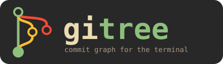
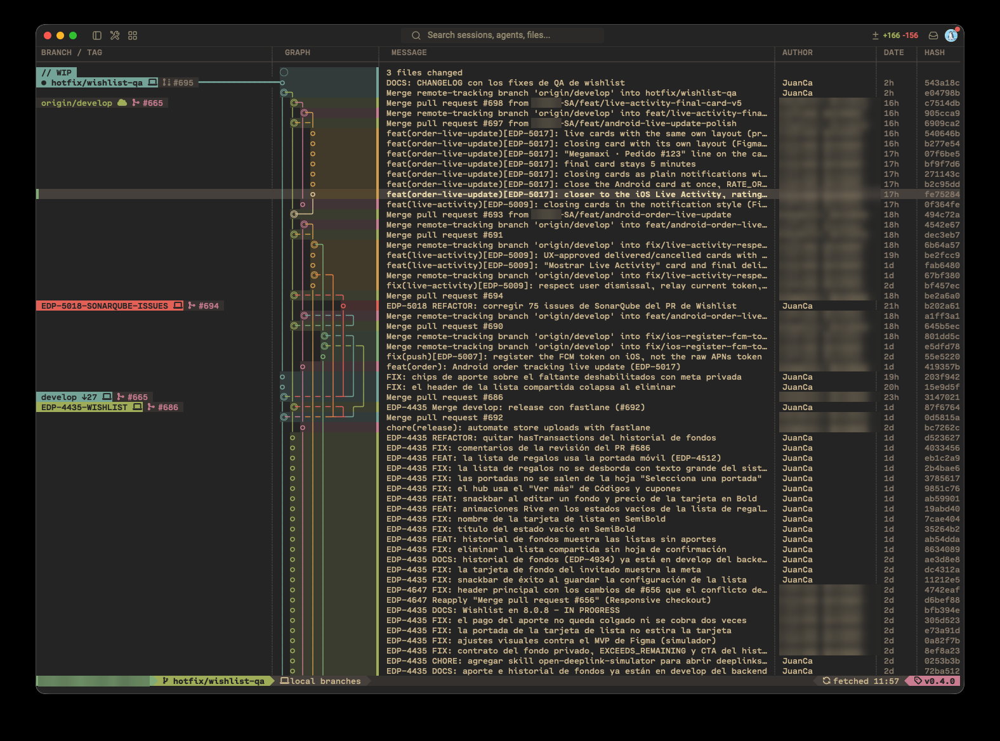
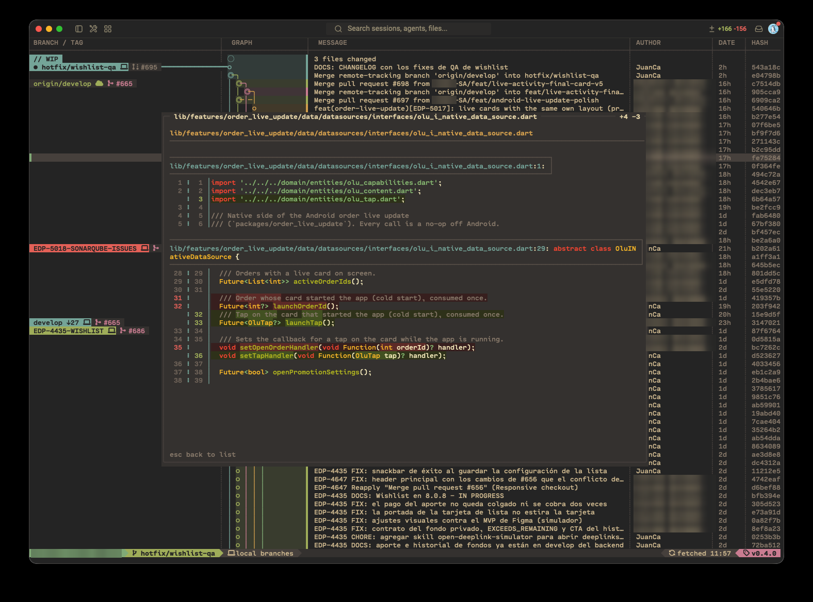

<p align="center">
  
</p>

<p align="center">
  <a href="https://github.com/Stratovarius93/gitree/releases/latest"></a>
  <a href="https://github.com/Stratovarius93/gitree/stargazers"></a>
  <a href="LICENSE"></a>
  
</p>

<p align="center">
A terminal app that shows your repository as a GitKraken-style commit table:
a colored commit graph, branch and tag labels in their own column, pull
request status, author and date, all in one keyboard-driven view.
</p>





## Why gitree?

Terminal git tools are great at *doing* things — staging, committing,
rebasing. gitree is built for *seeing*: one full-screen table that answers
"where is everything?" the way GitKraken does, without leaving the terminal.

- **The graph is the main view, not a side panel.** Every branch gets its own
  colored lane, each row is tinted with its lane color, and the branch you are
  on is joined to its commit by a line, so you find it at a glance.
- **Branches, tags and pull requests live in their own column.** Labels don't
  crowd the commit message: local and remote branches are merged into one
  pill, ahead/behind counts sit next to the name, and the PR state (open,
  draft, approved, changes requested, merged) shows as an icon, through `gh`.
- **It follows the repo on its own.** Commits, checkouts and branches made in
  another terminal or your editor appear within seconds, and the remote is
  fetched every minute. No need to restart or press refresh.
- **Safe by default.** Pull is fast-forward only, push never forces, a branch
  is only pushed to a branch of the same name, and every action asks first.
  When something can't run, a dialog says why and what you can do instead.
- **Plays well with lazygit.** gitree doesn't try to replace a full git
  client: press `L` to open lazygit in the same repo for staging, committing
  or resolving conflicts, and gitree reloads when you come back.

| | gitree | lazygit | tig | GitKraken |
| --- | --- | --- | --- | --- |
| Runs in the terminal | ✓ | ✓ | ✓ | — |
| Full-screen commit graph as the main view | ✓ | — | ✓ | ✓ |
| Branch/tag column beside the graph | ✓ | — | — | ✓ |
| Staging, committing, rebasing | via lazygit | ✓ | ✓ | ✓ |
| Free and open source | ✓ | ✓ | ✓ | — |

## Install

With Homebrew (macOS):

```sh
brew install stratovarius93/tap/gitree
```

Or with Go:

```sh
go install github.com/Stratovarius93/gitree@latest
```

(make sure `$(go env GOPATH)/bin` is in your `PATH`). Then run it inside any git
repository (or pass a path):

```sh
gitree [path]
```

## Optional dependencies

- [`delta`](https://github.com/dandavison/delta): nicer diffs in the preview.
- [`gh`](https://cli.github.com/): pull request icons (uses your active `gh` account).
- [`lazygit`](https://github.com/jesseduffield/lazygit): opened with `L`.
- A [Nerd Font](https://www.nerdfonts.com/) in your terminal, for the icons.

## Live updates

gitree follows the repository on its own, so commits, checkouts, new branches,
tags or stashes made in another terminal or your editor show up without
restarting:

- branches, tags, HEAD and the stash are checked every 2 seconds (a cheap
  check; the log only reloads when something changed);
- the working tree (the `// WIP` row) is checked every 10 seconds;
- both are checked right away when the terminal window gets focus back;
- the remote is fetched every minute.

A spinner (`⠋`) in the status bar shows while gitree is loading, fetching,
pulling, pushing or checking out. `r` still forces a full reload.

## Keys

The in-app help (`?`) shows the same table.

| Key | Action |
| --- | --- |
| `j` / `↓` | Down |
| `k` / `↑` | Up |
| `g` | Top |
| `G` | Bottom |
| `ctrl+d` | Half page down |
| `ctrl+u` | Half page up |
| `/` | Search in message, author, branches and hash |
| `n` | Next result |
| `N` | Previous result |
| `b` | Find a branch or tag and jump to it (type to filter; `↑`/`↓` or `ctrl+n`/`ctrl+p` move, `enter` jumps; switches to all branches when the ref is not in the current view) |
| `enter` | Open / close commit detail |
| `tab` | Switch focus |
| `esc` | Close |
| `space` | Preview |
| `x` | Action menu |
| `c` | Check out the selected branch (asks which when the row has several; a commit without branches is checked out detached). Always asks first: only `y` confirms |
| `y` | Copy branch name or hash |
| `o` | Open PR in the browser |
| `f` | Fetch |
| `p` | Pull (fast-forward only) |
| `P` | Push |
| `a` | Local branches / all |
| `L` | Open lazygit in this repo |
| `r` | Reload |
| `?` | Help |
| `q` | Quit |

## Checkout

`c` (or `x` → `c`) checks out the selected branch: a local branch directly, a
remote branch through its local copy, or a new local branch tracking it. On a
commit without branches it checks out the commit with a detached HEAD (the
question warns about it). It always asks first; only `y` confirms.

- **Check out with uncommitted changes** to tracked files: the "Can't check
  out" dialog lists the files and offers `s` — *Stash changes, check out
  <branch>, then restore them*. This is opt-in: a second question ("Stash N
  changed files, check out <branch>, then restore your changes?") must be
  answered with `y`. gitree then runs `git stash push` (tracked files only;
  untracked files stay where they are), checks out the branch and restores
  your changes with `git stash pop --index`, so staged changes stay staged.
  - If the checkout fails (for example an untracked file would be
    overwritten), your changes are restored on the original branch at once
    and the reason is shown.
  - If your changes conflict when restored, you stay on the new branch, your
    changes are kept safe in the stash (`git stash list`) and gitree offers
    lazygit to resolve them.
  - If the staged state can't be restored, the changes are restored unstaged
    and the status bar says so.
  - If a `post-checkout` hook fails (for example git-lfs is missing), the
    branch is still checked out: your changes are restored there and the
    status bar shows the hook's error.
  - gitree never drops a stash entry when something fails, and only drops its
    own entry while it is still the newest one.
  - Quitting (`q` / `ctrl+c`) while an action runs asks first (`y` quits, a
    second `ctrl+c` forces). If gitree is stopped between stashing and
    restoring, the next start (or reload) says that changes from an
    interrupted checkout are in the stash and offers `L` to restore them in
    lazygit.
  - Plain checkouts report a failing `post-checkout` hook the same way
    instead of an error.

## Pull and push

`p` and `P` work on the checked-out branch and always ask first: nothing
happens until you press `y` (`n` or `esc` cancels).

- **Pull** is fast-forward only (`git pull --ff-only`). It never merges or
  rebases, and `p` on its own never stashes. When the branch and its upstream
  have diverged, nothing is changed and gitree points you to lazygit (`L`). A
  branch whose upstream was deleted on the remote is not pulled.
- **Pull with uncommitted changes** to tracked files: the "Can't pull" dialog
  lists the changed files and offers `s` — *Stash changes, pull, and restore
  them*. This is opt-in: a second question ("Stash N changed files, pull M
  commits from origin/x, then restore your changes?") must be answered with
  `y`, and only then gitree runs `git pull --ff-only --autostash`. Untracked
  files are left alone. Staged changes come back unstaged (their content is
  kept); the question says so when you have any. If your changes conflict
  when they are restored, the pull stays applied, your changes are kept safe
  in the stash (`git stash list`), and gitree offers to open lazygit to
  resolve them. If the pull is interrupted (timeout) after git stashed your
  changes, gitree moves them into the stash too and offers lazygit to
  restore them.
- **Push** never forces. A push the remote rejects (it has commits you do not)
  changes nothing; pull first. If a remote hook refuses the push, its reason
  is shown. Uncommitted changes do not block a push: only commits are sent and
  the working tree is not touched.
- When pull, push, checkout, merge or cherry-pick can't run (uncommitted
  changes, diverged branches, an operation in progress, detached HEAD, no or
  deleted upstream, nothing to push, a fetch running, untracked files a
  checkout would overwrite), a "Can't …" dialog says **why** in one sentence,
  shows what is behind it (the changed files, the deleted upstream) and lists
  **what you can do**, each with its key: `s` stash and retry (pull and
  checkout), `L` lazygit (commit or stash, finish an operation, rebase or
  merge), `P` push to create or recreate the upstream, `f` fetch, `b` / `c`
  find or check out a branch. Pressing a key runs that path, still asking
  `y` before anything changes; `esc`, `enter` or `n` closes the dialog. Other
  errors from git stay in the status bar until the next success.
- A branch is only ever pushed to a branch **of the same name**:
  - with a same-named upstream, to that upstream;
  - without an upstream, or when the upstream has a different name (for
    example a branch created from `origin/main`) or is a local branch, to a
    new `origin/<branch>`, which becomes its upstream; the commits are never
    pushed onto the other branch;
  - when its upstream was deleted on the remote, the confirmation says so and
    the push recreates it.
- If the branch changes between the question and the push, nothing is pushed.
- Pull and push wait for a running fetch, and a fetch (`f` or the automatic
  one) waits for a running pull, push or other action.
- Detached HEAD: both are refused.

## PR icon legend

| Icon | Codepoints | State |
| --- | --- | --- |
|  | `U+F407` | Open |
|  | `U+F4DD` | Draft |
|  | `U+F407 U+F00C` | Approved |
|  | `U+F407 U+F00D` | Changes requested |
|  | `U+F419` | Merged |
|  | `U+F4DC` | Closed without merge |

Icons are Nerd Font glyphs.

## Credits

Graph rendering is adapted from [lazygit](https://github.com/jesseduffield/lazygit)
(MIT) by Jesse Duffield; its license is kept in `internal/graph/LICENSE`.

## License

MIT, see [LICENSE](LICENSE).
